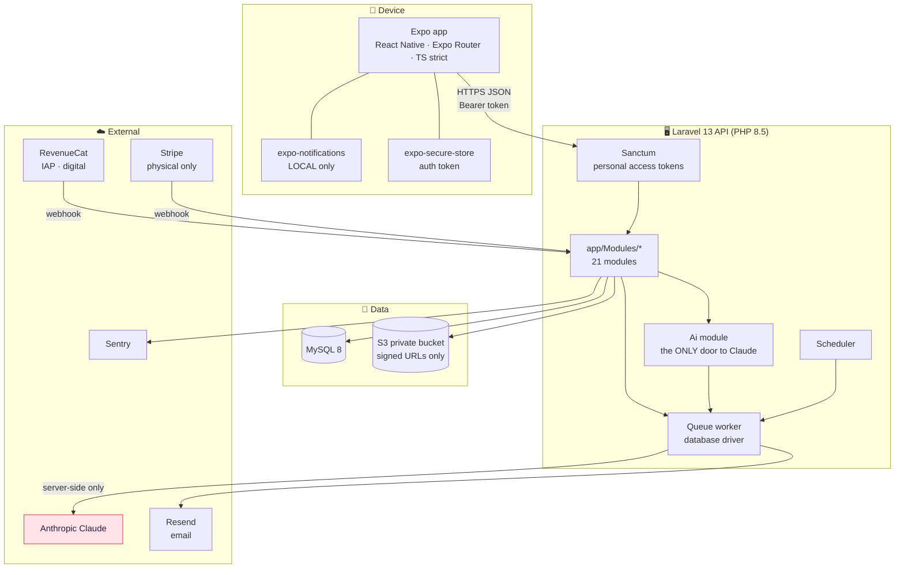
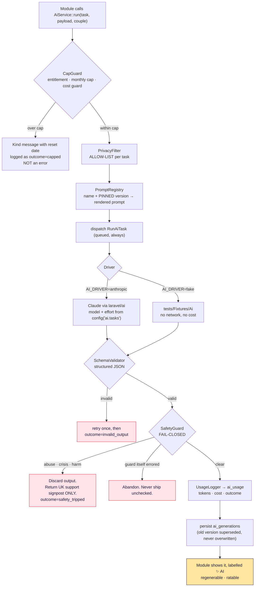

# Architecture — Swoon

**Last updated:** 2026-11-05

---

## 1. Shape of the system



**Three load-bearing properties:**

1. **The Anthropic key never leaves the server.** The app has no AI endpoint it
   can post a prompt to; it asks for a *date plan*, and the API decides what to
   send. There is no proxy.
2. **No remote push.** Local notifications are scheduled by the app from a
   server-declared desired state; email is the fallback. No device tokens exist
   anywhere (ADR-010).
3. **Entitlements are server-side.** The app renders what
   `GET /api/entitlements` says. A modified client gains nothing.

---

## 2. Request lifecycle

```
Expo app
  └─ TanStack Query hook
       └─ src/api/client.ts  (base URL, Bearer token, ApiError)
            └─ HTTPS
                 └─ Laravel: api middleware group
                      └─ Sanctum auth
                           └─ Module route  (app/Modules/<M>/routes.php)
                                └─ Form Request   validation
                                     └─ Policy    authorisation
                                          └─ Action     business logic
                                               └─ Model / Job
                                                    └─ API Resource  response
```

Conventions, enforced by review and Larastan level 6:

* **Form Requests** for validation — never `$request->validate()` in a controller.
* **API Resources** for every response — never a model or array returned raw.
* **Policies on every model** — authorisation is never an `if` in a controller.
* **Actions** hold business logic; controllers are thin and do four things:
  authorise, validate, call an Action, return a Resource.
* `declare(strict_types=1)` everywhere (enforced by Pint).

---

## 3. Data model

Everything belongs to a **Couple**. A handful of things belong to one partner and
are invisible to the other — those are the rows that need the most care.

```mermaid
erDiagram
    USERS ||--o{ COUPLE_USER : "member of"
    COUPLES ||--o{ COUPLE_USER : has
    USERS ||--o{ COUPLE_INVITES : sends
    COUPLES ||--|| COUPLE_ENTITLEMENTS : "entitled to"

    COUPLES ||--o{ MOMENTS : owns
    USERS ||--o{ MOMENTS : authors
    MOMENTS ||--o{ MOMENT_MEDIA : has
    MOMENTS }o--o{ TAGS : "tagged with"

    COUPLES ||--o{ DATE_PLAN_REQUESTS : requests
    DATE_PLAN_REQUESTS ||--o{ DATE_PLAN_ANSWERS : "collects (hidden)"
    DATE_PLAN_REQUESTS ||--o{ DATE_PLAN_OPTIONS : produces
    DATE_PLAN_OPTIONS ||--o{ DATE_PLAN_HEARTS : hearted
    DATE_PLAN_OPTIONS ||--o| PLANNER_EVENTS : schedules

    COUPLES ||--o{ PLANNER_EVENTS : plans
    PLANNER_EVENTS ||--o{ REMINDERS : triggers
    PLANNER_EVENTS ||--o| DATE_DEBRIEFS : "debriefed by"
    DATE_DEBRIEFS ||--o{ DATE_DEBRIEF_RESPONSES : "collects (hidden)"

    COUPLES ||--o{ MILESTONES : marks
    MILESTONES ||--o{ PLANNER_EVENTS : "generates yearly"

    COUPLES ||--o{ SPARK_PROMPTS : "asked daily"
    SPARK_QUESTIONS ||--o{ SPARK_PROMPTS : "drawn from"
    SPARK_PROMPTS ||--o{ SPARK_ANSWERS : "collects (hidden)"

    COUPLES ||--o{ COUPLE_CHALLENGES : "set weekly"
    CHALLENGES ||--o{ COUPLE_CHALLENGES : "drawn from"
    COUPLE_CHALLENGES ||--o{ CHALLENGE_COMPLETIONS : completed
    COUPLES ||--o{ STREAKS : "builds (pausable)"

    COUPLES ||--o{ LOVE_NOTES : "holds (locked)"
    COUPLES ||--o{ WISHLIST_ITEMS : shares
    COUPLES ||--o{ GIFT_VAULT_ITEMS : "holds (PRIVATE)"
    COUPLES ||--o{ BUCKET_LIST_ITEMS : shares
    COUPLES ||--o{ CHECK_IN_RESPONSES : "holds (PRIVATE)"

    USERS ||--o{ LOVE_MAP_ENTRIES : fills
    LOVE_MAP_FIELDS ||--o{ LOVE_MAP_ENTRIES : defines

    COUPLES ||--o{ RECAPS : receives
    COUPLES ||--o{ INSIGHTS : receives
    COUPLES ||--o{ YEAR_RECAPS : receives
    COUPLES ||--o{ AI_USAGE : "costs"
    COUPLES ||--o{ AI_GENERATIONS : "shown"
    AI_GENERATIONS ||--o{ AI_FEEDBACK : rated
    AI_GENERATIONS ||--o| RECAPS : backs
    AI_GENERATIONS ||--o| INSIGHTS : backs
    AI_GENERATIONS ||--o{ DATE_PLAN_OPTIONS : backs

    COUPLES ||--o{ ORDERS : places
    COUPLES ||--o{ DATE_ROULETTE_SPINS : spins
    DATE_IDEAS ||--o{ DATE_ROULETTE_SPINS : "drawn from"
```



### 3.1 Privacy classes

Every table falls into exactly one class. Knowing which is how you know what the
API may return.

| Class | Meaning | Tables |
|---|---|---|
| **Shared** | Both partners read; usually both write | `couples`, `planner_events`, `moments` (unless private), `wishlist_items`, `bucket_list_items`, `milestones`, `couple_challenges`, `recaps`, `insights`, `year_recaps`, `date_ideas` |
| **Author-owned** | Both read; only the author writes | `moments`, `wishlist_items` |
| **Hidden until reveal** | Withheld by the API until both partners contribute, then shared forever | `date_plan_answers`, `spark_answers`, `date_debrief_responses` |
| **Permanently private** | Never visible to the partner, under any setting | `gift_vault_items`, `check_in_responses`, `love_notes` (until unlock), `love_map_entries` (where `visibility = private`), `moments` (where `is_private`), `ai_feedback`, `orders` |

Two rules follow, and they are tested per module:

* A **hidden-until-reveal** field is *absent from the JSON* before the reveal —
  not merely unrendered (ADR-005).
* A **permanently private** row never appears in the partner's index, detail,
  search, data export, or any AI payload that produces shared output.

### 3.2 Conventions

* Surrogate `bigint` primary keys; a public **ULID** on anything the app
  references or a deep link exposes.
* `couple_id` on every couple-scoped table, indexed first in composite indexes —
  almost every query is couple-scoped.
* Timestamps are UTC in the database. **Display and scheduling use the user's
  timezone**, which is why `users.timezone` and per-event `timezone` exist.
* Money is **integer pence**. Never a float.
* Soft deletes only where undo exists (`moments`) or detachment matters
  (`couples`).
* `enum`-like columns are strings validated by a PHP enum, not MySQL `ENUM` —
  adding a value should not need a migration.

---

## 4. The AI pipeline

One path, no exceptions. Every AI feature calls `AiService::run()`.



### 4.1 Rules that make this safe

| Rule | Why |
|---|---|
| **Queued, always** | A slow model must never become a slow API. |
| **Prompts are versioned files**, pinned in config | Adding a file cannot silently change behaviour; a change is a visible config edit plus an `AI_PROMPTS.md` entry. |
| **Allow-list, not deny-list** | A newly added private column is excluded by default. A deny-list rots the moment someone forgets. |
| **SafetyGuard is a separate step** | Not a sentence in a prompt. It is independently tested, and it **fails closed** — a broken guard produces no output rather than unchecked output. |
| **Caps before dispatch** | We never pay for a call we were going to refuse. |
| **Everything logged** | `ai_usage` records failures too. An unlogged call is a bug. |
| **Model ids from config** | A model upgrade is one line; tests pin a fake. |
| **Generations are superseded, not overwritten** | What the couple was shown stays true even after a prompt change. |

### 4.2 What never reaches a prompt

Gift vault entries · individual check-in answers · locked love notes · private
moments · private love-map entries · the other partner's un-revealed answers ·
auth credentials · email addresses · full postcodes or coordinates · shipping
addresses.

The date planner stores and sends the **postcode outcode only** (`NE1`, not
`NE1 4ST`) — enough to be useful, not enough to locate a home.

### 4.3 Tasks

| Task | Model key | Effort | Cap (Together) | Prompt |
|---|---|---|---|---|
| `date_plan` | strong | high | 20/month | `date_plan` v1 |
| `weekly_recap` | strong | medium | 5/month | `weekly_recap` v1 |
| `insights` | strong | medium | 10/month | `insights` v1 |
| `year_in_moments` | strong | high | annual | `year_in_moments` v1 |
| `date_pack` | strong | medium | — (authoring) | `date_pack` v1 |
| `safety_screen` | light | low | — (internal) | `safety_screen` v1 |
| `moment_tagging` | light | low | generous | `moment_tagging` v1 |
| `spark_question` | light | low | — (authoring) | `spark_question` v1 |

`date_roulette` appears nowhere on purpose: it is the **zero-AI-cost** fallback,
free and instant for everyone (see its `module.md`).

---

## 5. Background work

Herd serves HTTP but runs neither the queue nor the scheduler. `composer dev`
supplies both, plus a log tail.

| Schedule | Frequency | Purpose |
|---|---|---|
| `reminders:dispatch` | 15 min | Queue due email reminders |
| `love-notes:unlock` | 15 min | Unlock due notes; content-free email |
| `spark:assign` | hourly | Assign the day's question per local midnight |
| `challenges:assign` | hourly | Assign the week's set per local week start |
| `recaps:generate` | hourly | Generate for couples whose local week closed |
| `debriefs:offer` | hourly | Offer a debrief after a date passes |
| `trials:expire` | hourly | End 7-day trials |
| `milestones:generate` | daily | Top up the rolling 12-month event window |
| `gift-vault:remind` | daily | Author-only gift reminders |
| `insights:generate` | weekly | At most one insight per couple |
| `ai:report-costs` | daily | Per-couple and global cost summary + alert |
| `invites:prune` | daily | Remove expired invites |
| `moments:purge-deleted` | daily | Hard-delete after 30 days |
| `date-plans:expire` | daily | Expire unanswered plan requests |
| `billing:reconcile` | daily | Safety net for missed webhooks |
| `check-in:offer` | weekly | Per-user, local time |

**Anything hourly-or-finer is per-couple-local-time aware**: a couple in Sydney
gets their Monday recap on *their* Monday. That is why these run hourly rather
than once a day in UTC.

---

## 6. Media

```
App → POST /api/moments/{id}/media  → signed upload target
App → PUT  (direct to S3)
Job → ProcessMomentPhoto  (resize · thumbnail · STRIP EXIF INCLUDING GPS)
Job → TranscodeVoiceNote  (single compact format, 60 s cap)
App → GET  /api/moments/{id}  → short-lived signed URLs (15 min default)
```

* **Private bucket. No public URL, ever.**
* **EXIF including GPS is stripped on upload.** A product that promises not to
  track location must not let a photo leak one.
* Originals are kept for the printed book; display sizes serve the app.
* Uploads are **separate from the record**, so a moment's text lands even while a
  photo is still uploading (UX rule 11).
* Local dev uses the `local` disk and needs no S3 credentials.

---

## 7. Offline and sync

Moments and planner items are creatable offline (UX rule 11).

1. The app writes to a local queue with a **client-generated ULID**.
2. The item appears immediately, showing "Saving…".
3. On reconnect it is POSTed. **The server treats the ULID as an idempotency
   key**, so a retry or a duplicated send cannot create two rows.
4. Success → "Saved". Permanent failure → it stays local and says so. Nothing
   silently disappears.

Media queues separately from its record, so a large photo on a poor connection
never blocks the text.

---

## 8. Authentication

* **Sanctum personal access tokens.** No cookies, no CSRF, no stateful domains —
  the client is a mobile app.
* The token lives in **`expo-secure-store`**, never AsyncStorage.
* Social sign-in verifies the Apple/Google identity token **server-side** and
  issues our own token. The provider token is never used as our session.
* Sign in with Apple may return a private-relay email, and returns the real name
  **only on first authorisation** — capture it then or never.
* Logout revokes the current token only, so signing out of one device does not
  sign out the other.

---

## 9. Testing

| Layer | Tool | Where |
|---|---|---|
| API | Pest 4 | `api/tests/{Unit,Feature}` |
| Mobile | Jest + React Native Testing Library | `mobile/src/**/__tests__` |
| Contrast gate | Jest | `mobile/src/theme/__tests__/contrast.test.ts` |
| Critical path | Maestro | `maestro/` — sign up → invite → accept → plan a date |

Standing requirements:

* **No test makes a real AI call.** `AI_DRIVER=fake` is pinned in `phpunit.xml`,
  along with dummy Resend, Stripe and RevenueCat keys.
* **Every endpoint has an authorisation test** proving a second couple gets
  403/404 (Phase 10 makes this a gate).
* **Every privacy rule has a test asserting absence from the JSON**, not absence
  from the screen.
* The palette cannot regress: the contrast test includes a case asserting the
  **pre-fix** Cherry still fails, so the gate cannot rot into a no-op.

---

## 10. Environments

| | Local | Production (planned) |
|---|---|---|
| API | Herd, `https://swoon-api.test` | TBD |
| DB | MySQL 8 on 3306 | MySQL 8 |
| Queue | `database` + `composer dev` | `database` or Redis + supervised worker |
| Mail | `log`, then Resend once the domain is verified | Resend |
| Storage | `local` disk | S3 private bucket |
| AI | `AI_DRIVER=anthropic`, or `fake` | `anthropic` |
| Errors | DSN empty (SDK inert) | Sentry, `send_default_pii=false` |

Phones and emulators cannot resolve `.test` — see `docs/DEV_TOOLING.md`.
